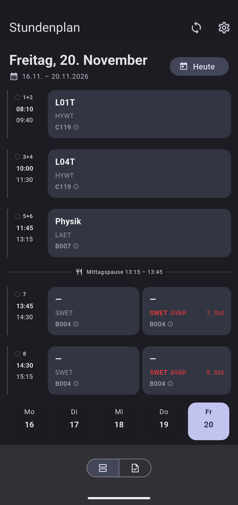
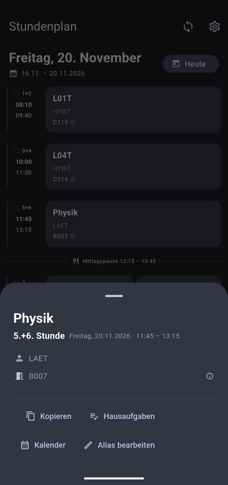
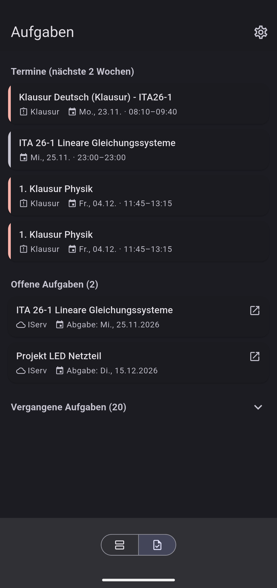
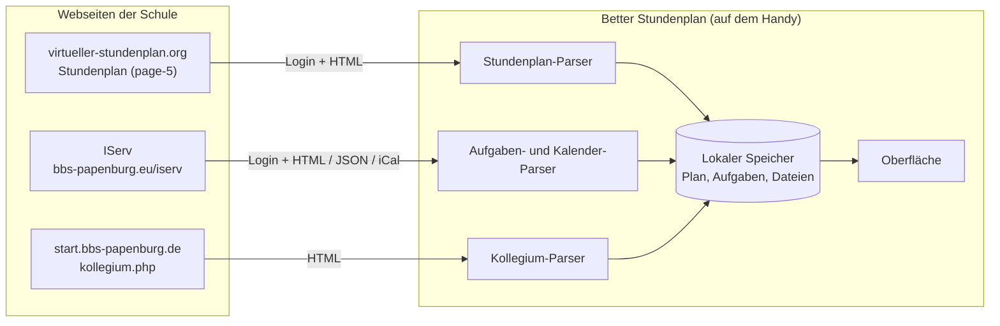
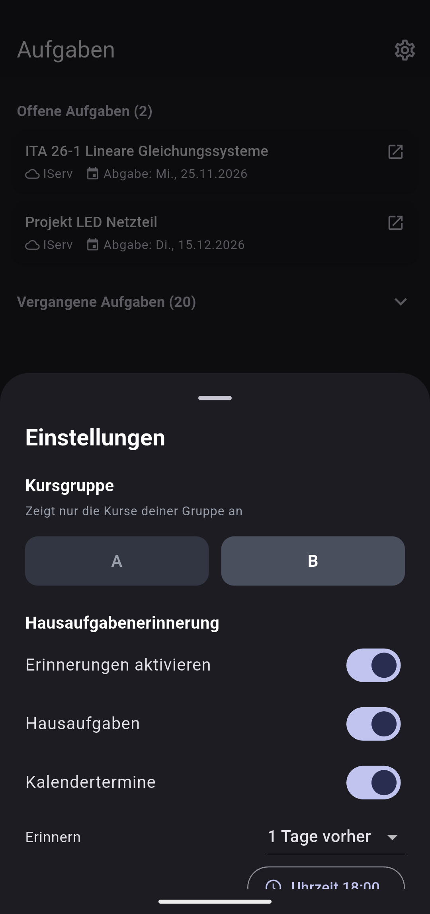
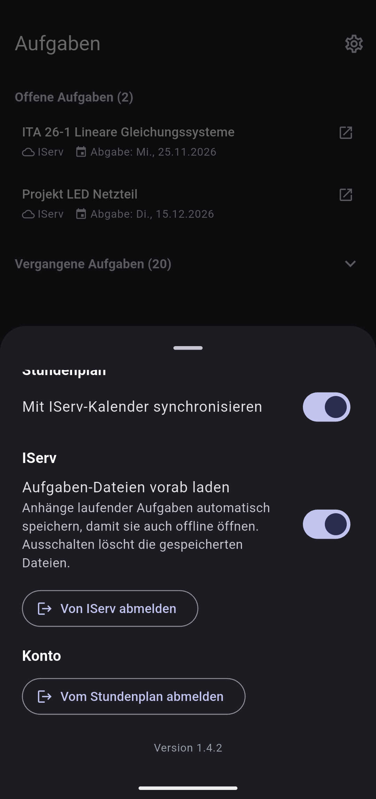

# Better Stundenplan

Ein (hoffentlich) nicht ganz so schlechter Client für [virtueller-stundenplan.org](https://virtueller-stundenplan.org).

Dieses Projekt entsteht im Rahmen eines Schulprojekts, in dem wir mit Unterstützung Künstlicher Intelligenz eine App entwickeln.

> [!NOTE]
> [Datenschutzerklärung](assets/datenschutz.md)

> [!IMPORTANT]
> **ACHTUNG:** Der Code könnte absolut grauenhaft sein!

<p align="center">
  
  
  
</p>

## Inhalt

- [Was macht die App?](#was-macht-die-app)
- [Woher kommen die Daten?](#woher-kommen-die-daten)
- [Die Ansichten im Detail](#die-ansichten-im-detail)
- [Offline-Modus](#offline-modus)
- [Datenschutz und Zugangsdaten](#datenschutz-und-zugangsdaten)
- [Installation](#-installation)
- [Selbst bauen](#selbst-bauen)

## Was macht die App?

Die Schule veröffentlicht den Stundenplan auf [virtueller-stundenplan.org](https://virtueller-stundenplan.org). Die Seite ist für den Browser gemacht und auf dem Handy unhandlich. Die App meldet sich dort mit deinem Zugang an, liest die Seite aus und zeigt dir den Plan übersichtlich an: Vertretungen und Raumänderungen sind sofort erkennbar. Zusätzlich kann sie sich bei IServ anmelden und zeigt dann Aufgaben und Kalendertermine (z. B. Klausuren) direkt neben dem Stundenplan.

Es gibt **keinen eigenen Server**. Die App spricht direkt mit den Seiten der Schule; alles, was sie speichert, bleibt auf deinem Handy.

## Woher kommen die Daten?

Die App hat drei Datenquellen. Keine davon hat eine offizielle Schnittstelle (API). Die App lädt deshalb dieselben Webseiten wie der Browser und liest die Informationen aus dem HTML heraus („Scraping“).



### 1. Stundenplan: virtueller-stundenplan.org

1. **Login:** Die App schickt E-Mail und Schülercode per POST an `virtueller-stundenplan.org/index.php`. Bei Erfolg antwortet der Server mit einem Cookie (`PHPSESSID`), der ab jetzt die Anmeldung ersetzt.
2. **Plan abrufen:** Mit diesem Cookie lädt die App `…/page-5/index.php?KlaBuDatum=<Datum>`. Die Antwort enthält die **ganze Woche (Mo–Fr)** als eine HTML-Tabelle. Das Datum bestimmt nur, welche Woche kommt.
3. **Parsen:** Der Parser (`stundenplan_parser.dart`) zerlegt die Tabelle in Tage, Blöcke und Kurse. Vertretungen erkennt er am HTML: Die ursprüngliche Lehrkraft steht durchgestrichen (`<del>`), die Vertretung folgt mit einem `+`. In der App erscheint das rot durchgestrichen, wie in der Tagesansicht oben bei „SWET ~~SYEP~~“.
4. **Filtern:** Der generelle Plan enthält Kurse mehrerer Gruppen. Mit der **Kursgruppe** (A oder B, in den Einstellungen) blendet die App alle Kurse aus, die nicht zu dir gehören.
5. **Abgelaufene Sitzung:** Leitet der Server auf die Login-Seite um, meldet sich die App im Hintergrund mit den gespeicherten Zugangsdaten neu an und lädt die Woche noch einmal. Du bekommst davon nichts mit.

### 2. Aufgaben und Kalender: IServ

Die IServ-Anmeldung ist **optional und getrennt** vom Stundenplan-Login. Ohne sie funktionieren Stundenplan und lokale Hausaufgaben trotzdem.

- **Login:** Die App folgt der Anmeldung von IServ Schritt für Schritt (inklusive Weiterleitungen), sammelt die Session-Cookies und schickt sie bei jedem weiteren Aufruf mit. Die Cookies werden gespeichert, damit die Anmeldung einen App-Neustart überlebt.
- **Aufgaben:** Aus `/iserv/exercise` liest die App die Tabelle der offenen und vergangenen Aufgaben (Titel, Abgabetermin). Tippst du eine Aufgabe an, lädt sie deren Detailseite (Beschreibung, Anhänge).
- **Kalender:** Die App fragt den Kalender-Feed von IServ (`/calendar/feed/calendar-multi`) ab. Für ältere IServ-Versionen gibt es einen Rückfallweg über die Kalenderseite und iCalendar-Exporte (`.ics`). Termine, deren Titel oder Kalender „Klausur“ enthält, werden als Klausur markiert.
- **Zuordnung zum Plan:** Termine und Aufgaben werden den passenden Stunden im Stundenplan zugeordnet. Dort zeigt ein kleines Kalender-Symbol, dass etwas ansteht.

### 3. Lehrkräfte: Kollegiumsseite

Im Plan stehen nur Kürzel (z. B. „LAET“). Die App liest einmal die Kollegiumsseite der Schule (`start.bbs-papenburg.de/kollegium.php`) und ordnet jedem Kürzel den vollen Namen und das Foto zu. Das Ergebnis wird zwischengespeichert.

### 4. Nur auf dem Gerät: lokale Hausaufgaben und Aliasse

Hausaufgaben, die du aus einer Stunde heraus einträgst, und Aliasse für Fächer, Lehrkräfte und Räume (z. B. „PO“ für „Politik“) werden **nur lokal** gespeichert. Sie gehen an keinen Server.

## Die Ansichten im Detail

### 🗓 Tagesansicht


Der Startbildschirm zeigt einen Tag mit allen Blöcken (1+2, 3+4, 5+6, 7, 8) samt Uhrzeiten und der Mittagspause.

- Unten wechselst du den Wochentag, „Heute“ springt zum aktuellen Tag, ein Tipp auf die Wochenspanne wechselt die Woche.
- Laufen zwei Kurse parallel, stehen sie nebeneinander.
- **Rot und durchgestrichen** ist eine Vertretung oder ein Ausfall.
- Das `ⓘ` hinter dem Raum erklärt das Raumkürzel: `C119` ist Gebäude C, Etage 1, Raum 19.
- Oben rechts startet das Symbol mit den Pfeilen eine Aktualisierung, das Zahnrad öffnet die Einstellungen.

<br clear="right">

### 🔍 Details einer Stunde


Ein Tipp auf eine Stunde öffnet ein Detailfenster mit Fach, Block, Datum, Uhrzeit, Lehrkraft und Raum. Von hier aus kannst du:

- **Kopieren:** die Stundeninfos in die Zwischenablage legen.
- **Hausaufgaben:** Hausaufgaben zu genau dieser Stunde eintragen oder ansehen.
- **Kalender:** den Tageskalender mit allen IServ-Terminen dieses Tages öffnen.
- **Alias bearbeiten:** Fach, Lehrkraft oder Raum umbenennen.

<br clear="right">

### 📝 Aufgaben und Termine


Der zweite Tab unten bündelt alles, was ansteht:

- **Termine der nächsten 2 Wochen** aus dem IServ-Kalender. Klausuren sind rot markiert.
- **Offene Aufgaben** von IServ mit Abgabetermin. Das Symbol rechts öffnet die Aufgabe in IServ.
- **Vergangene Aufgaben** lassen sich aufklappen.
- Deine **lokalen Hausaufgaben** stehen ebenfalls hier. Du kannst sie als erledigt markieren, dann verschwinden sie. Erledigte Hausaufgaben samt Bildern werden nach 24 Stunden endgültig gelöscht.

Lokale Hausaufgaben trägst du aus der jeweiligen Stunde heraus ein. Fach und Lehrkraft kommen automatisch aus dem Stundenplan, Doppelstunden (1+2, 3+4, 5+6, 7+8) werden unterstützt, und du kannst Fotos anhängen. Bilder öffnen sich im Vollbild, das als einzige Ansicht auch Querformat erlaubt.

<br clear="right">

### ⚙️ Einstellungen

<p>
  
  
</p>

- **Kursgruppe** (A/B): zeigt nur die Kurse deiner Gruppe.
- **Hausaufgabenerinnerung:** Benachrichtigungen für Hausaufgaben und Kalendertermine, einstellbar wie viele Tage vorher und um welche Uhrzeit. Klausuren erinnern zusätzlich am Vorabend um 18:00 Uhr.
- **Mit IServ-Kalender synchronisieren:** Termine in den Plan einblenden.
- **Aufgaben-Dateien vorab laden:** Anhänge laufender Aufgaben automatisch speichern, damit sie auch offline funktionieren.
- **Abmelden:** getrennt für IServ und für den Stundenplan.

## Offline-Modus

Die App ist „offline-first“: Sie zeigt immer zuerst, was sie schon gespeichert hat, und aktualisiert danach im Hintergrund.

- **Stundenplan:** Jede geladene Woche wird als Datei auf dem Handy abgelegt. Gibt es kein Internet, bleibt der gespeicherte Stand sichtbar. Sobald wieder eine Verbindung besteht, lädt die App automatisch neu. Es wird nur dann neu gezeichnet, wenn sich wirklich etwas geändert hat.
- **IServ-Aufgaben:** Detailseite und Anhänge laufender Aufgaben werden nach jedem erfolgreichen Laden im Hintergrund heruntergeladen. Ist eine Aufgabe vorbei, löscht die App ihre Dateien wieder. Das lässt sich in den Einstellungen abschalten.

## Datenschutz und Zugangsdaten

- Zugangsdaten werden **verschlüsselt im Android Keystore** abgelegt (Plattform-Funktion, nicht in Klartext-Einstellungen). Sie dienen nur dazu, dich still neu anzumelden, wenn eine Sitzung abläuft.
- Die App sendet Daten **ausschließlich** an die oben genannten Seiten. Es gibt keinen Analyse- oder Werbedienst und keinen eigenen Server.
- „Alle App-Daten löschen“ in den Einstellungen entfernt alles, was die App gespeichert hat.
- „Abmelden“ in den Einstellungen löscht die gespeicherten Zugangsdaten bzw. die IServ-Dateien.
- Schlägt eine automatische IServ-Anmeldung fehl (z. B. nach einer Passwortänderung), wartet die App 30 Minuten, bevor sie es erneut versucht. So wird dein Konto nicht durch viele Fehlversuche gesperrt.

## 📥 Installation
Aktuell steht die App auf f-droid und als APK bereit :)

[](https://f-droid.org/packages/in.eike.better_stundenplan)
[](https://github.com/LarvenStein/better-stundenplan/releases)

## Selbst bauen

Die App ist in [Flutter](https://flutter.dev) geschrieben. Die benötigte Flutter-Version steht in der CI-Konfiguration (`.github/workflows/build.yml`).

```bash
flutter pub get
flutter test          # Unit- und Widget-Tests
flutter run           # mit angeschlossenem Handy oder Emulator
flutter build apk     # APK bauen
```

Wo was liegt:

| Ordner | Inhalt |
| --- | --- |
| `lib/services/` | Netzwerk, Parser, Caches, Login (`stundenplan_*`, `iserv_*`, `session_manager.dart`) |
| `lib/models/` | Datenmodelle für Wochen, Tage und Stunden |
| `lib/pages/` | Seiten (Start, Login, Aufgaben, Kalender, Details) |
| `lib/components/` | wiederverwendbare Bausteine (Stundenkarte, Tagesauswahl, Einstellungen) |
| `test/` | Tests, u. a. für die Parser |
